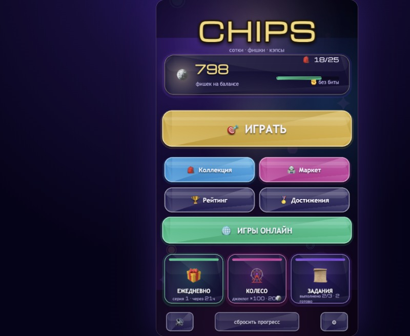
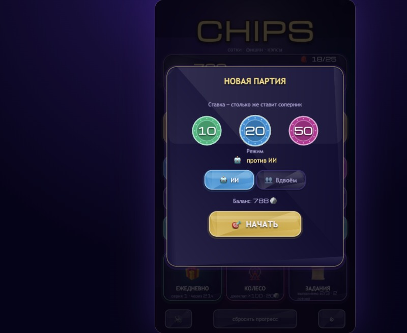
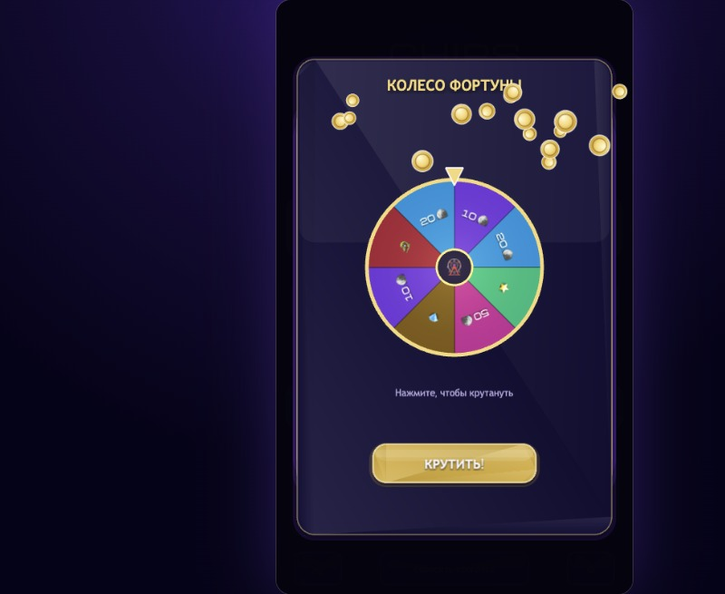
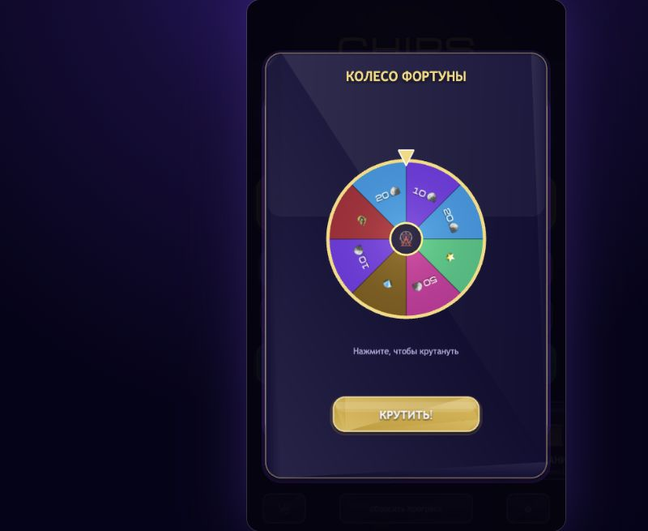
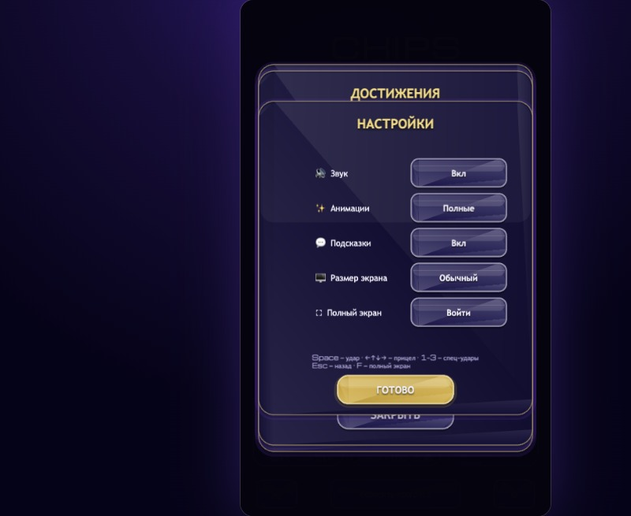
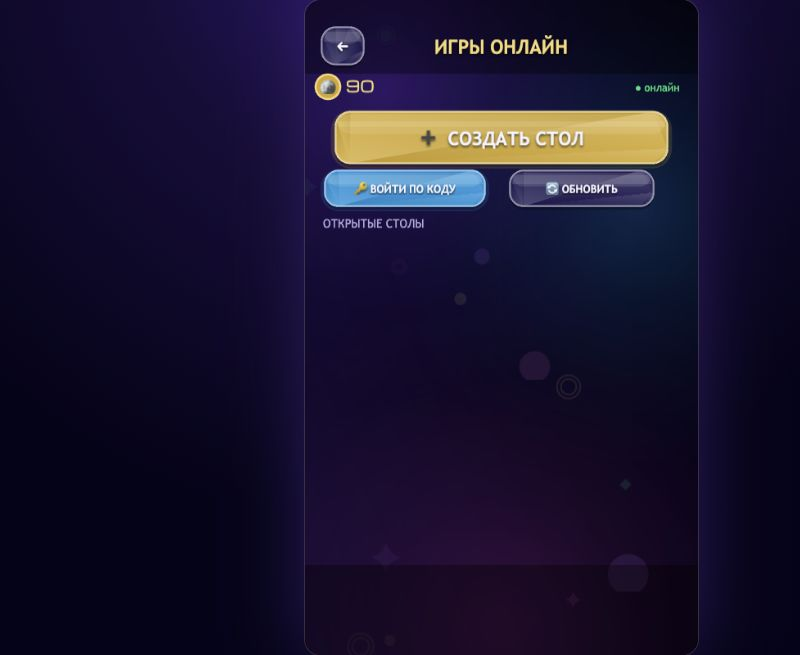
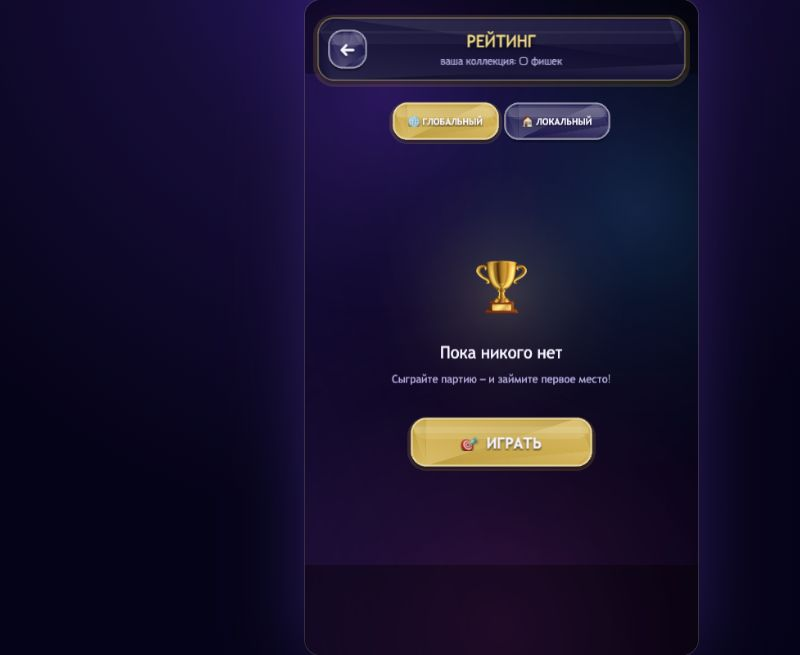
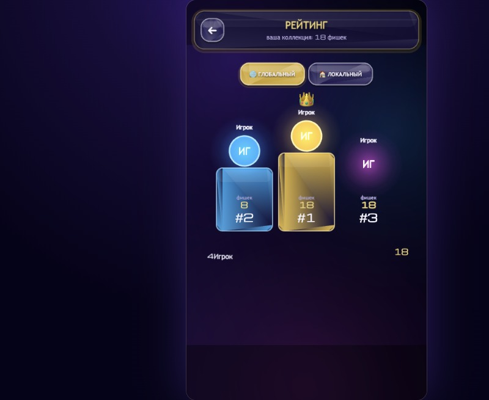
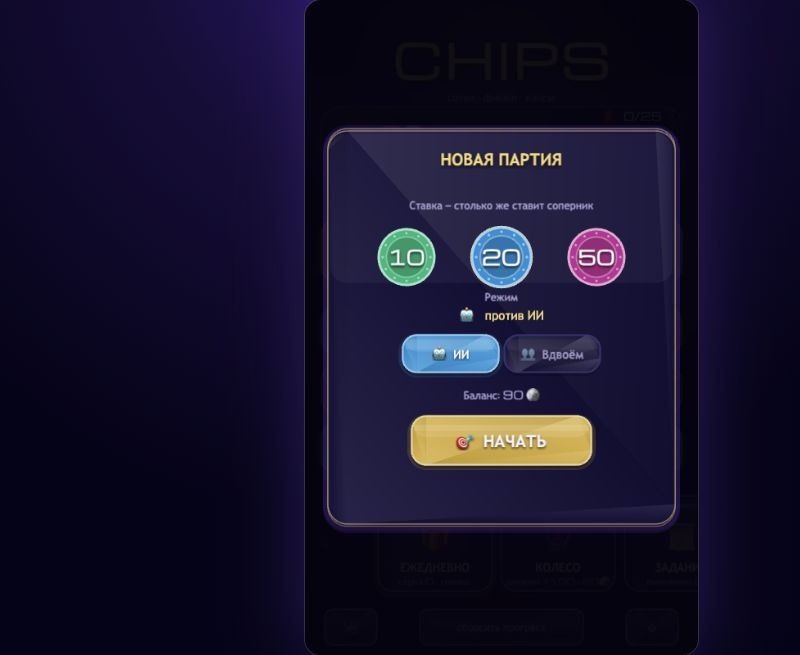

# CHIPS — дворовые «Сотки» в браузере

[](https://github.com/KnowerLife/CHIPS/actions/workflows/ci.yml)
[](LICENSE)

> *Асфальт ещё хранит тепло летнего дня. В кармане — тяжёлая бита, в кулаке — стопка заветных «соток» с потертыми краями и чужими победами.  
> Кто-то кричит: «На кон!» — и мир сужается до столбика фишек, замаха и короткого, звонкого удара.  
> Мы делали **CHIPS**, чтобы вернуть этот двор из 90-х: азарт промаха, радость редкой находки, шум компании и ту самую коллекцию, которую бережно пересчитывали дома перед сном.*

**CHIPS** — веб-игра по мотивам дворовой классики **«Сотки / Фишки / Кэпсы»** (POG). Бей битой по стопке, выбивай фишки себе в копилку, собирай коллекции, крути колесо удачи и играй с друзьями — на одном экране, онлайн или прямо в Telegram.

---

## Скриншоты

### Главное меню и игра

| Меню | Матч | Выбор ставки |
| --- | --- | --- |
|  |  |  |

### Прогресс и награды

| Ежедневная награда | Колесо фортуны | Задания |
| --- | --- | --- |
|  |  |  |

| Достижения | Коллекция | Маркет |
| --- | --- | --- |
|  |  |  |

### Онлайн, рейтинг и настройки

| Онлайн-столы | Глобальный рейтинг | Локальный рейтинг |
| --- | --- | --- |
|  |  |  |

| Настройки |
| --- |
|  |

---

## Как играть — правила «Соток»

### Цель
Выбить из стопки больше фишек, чем соперники, и забрать их себе в баланс и коллекцию.

### Подготовка и ход матча
1. **Ставка.** Игроки делают ставку `stake` — из неё формируется общая стопка (`2 × stake` фишек рубашкой вверх).
2. **Стопка.** Фишки в стопке подбираются из каталога случайно, с учётом редкости.
3. **Очередь.** Ходят по очереди (первый ход определяется жребием).
4. **Удар.** Бьющий делает замах, выбирает силу и точку удара по столбику. Для каждой фишки рассчитывается шанс переворота: он зависит от мощности биты, силы замаха, веса фишки, её глубины в стопке и точности прицела.
5. **Результат удара.** Все перевернувшиеся фишки уходят в копилку бьющего. Оставшиеся снова собираются в столбик; раз за ход стопка перемешивается.
6. **Бонусная находка.** С некоторым шансом удар может выбить бонусную фишку прямо в коллекцию (шанс зависит от биты; редкая/эпическая/легендарная находка — отдельная удача).
7. **Конец партии.** Игра идёт, пока стопка не опустеет (есть предохранитель на число ходов). Побеждает тот, кто собрал больше фишек. Возможна ничья.

### Управление — удар «как бросок камня»
Удар — это жест, а не просто кнопка:

- **Зажать** (палец/мышь/`Space`) — начать замах: шкала силы качается вверх-вниз.
- **Вести** вдоль столбика (палец/мышь/стрелки `← ↑ ↓ →`) — навести прицел (верх/низ стопки).
- **Отпустить** — ударить с текущей силой и прицелом.

Сила отвечает за то, *насколько сильно* бьём, прицел — *куда* в столбик.

**Клавиатура (десктоп):** `Space` — замах/удар, `←↑↓→` — прицел, `1`/`2`/`3` — спец-удары, `Esc` — назад/выход, `F` — полный экран.

### Промах и «переход»
Если за ход не перевернулась ни одна фишка — это промах. Следующий игрок получает бонус к прицелу (**«переход»**): +12% (накапливается, но не выше +24%) на первый удар по выбранной точке. Бонус помогает тому, кто метко целится, и тратится на первый удар получателя.

### Спец-удары
На своём ходу можно потратить уже выбитые фишки из копилки — они возвращаются **рубашкой вниз в низ стопки** (общее число фишек в партии не меняется):

| Удар | Цена | Эффект |
| --- | --- | --- |
| 🎯 **Точный** | 2 фишки | Гарантирует минимум 2 переворота у точки прицела |
| 🛡 **Отбой** | 1 фишка | Следующий соперник бьёт на 25% слабее (на один удар) |
| ⚡ **Двойной** | 1 фишка | Два удара за один ход (два прохода по стопке) |

- На добивающем ходу (когда стопка опустела) спец-удар бесплатен.
- Если фишек на оплату не хватает — удар выполняется как обычный.

### Что влияет на шанс переворота
Модель удара близка к «ощущению» реальных соток:

- **Сила замаха** и **мощность биты** увеличивают шанс.
- **Вес фишки** снижает шанс (тяжёлые перевернуть сложнее).
- **Глубина в стопке** снижает шанс (глубокие фишки «защищены» верхними).
- **Прицел** даёт заметную прибавку фишкам в зоне удара.
- **«Отбой»** соперника временно ослабляет вашу силу.

ИИ играет по тем же правилам: оценивает ожидаемые перевороты, целится, регулирует силу и иногда использует спец-удары.

---

## Режимы игры

- **1v1 против ИИ** — быстрая партия с ботом.
- **Локальный хот-сит** — вдвоём за одним экраном/устройством.
- **Онлайн (2–10 игроков)** — столы со ставкой, числом мест и паролем:
  - публичный список столов («Игры онлайн»),
  - приглашение по ссылке/коду,
  - боты-соперники за столом,
  - сервер авторитетно считает исход каждого удара (RNG и расчёт на сервере).
- **Telegram Mini App** — вход через Telegram, шаринг стола в чат, покупки за Telegram Stars.

---

## Экономика, коллекция и мета-прогрессия

Две сущности: **баланс** (валюта — фишки) и **коллекция** (конкретные фишки-предметы). Выбитые в партии фишки пополняют и баланс, и коллекцию. Прогресс сохраняется в `localStorage` (автосохранение).

### Приток и отток
| Приток (faucets) | Отток (sinks) |
| --- | --- |
| Ежедневная награда (серия дней даёт бонус) | Ставки в партиях |
| Колесо фортуны | Покупка бит в маркете |
| Награды за достижения | Плата за вращение колеса |
| Ежедневные задания (3 в сутки) | Дубликаты, сжигаемые в кузнице |
| Продажа дубликатов |  |
| Награды за собранные серии коллекции |  |
| Покупки наборов (в т.ч. ⭐ в Telegram) |  |

### Коллекция и серии
- Фишки разных редкостей и серий (Chupa Caps, Mortal Kombat, POG, Pokémon, Turtles, Gold и др.).
- **Серия** собрана, когда есть хотя бы по одному экземпляру каждой фишки серии — за это начисляется награда (один раз на серию).
- Дубликаты можно продать или отправить в кузницу.

### Ежедневные задания
Каждый день (по локальной дате) выдаются 3 детерминированных задания из пула (победы, выбитые фишки, спец-удары, продажи, колесо, новые находки). За выполнение — награды в фишках.

### Кузница бит
Дубликаты переплавляются в **очки кузницы** (ценность зависит от редкости; последний экземпляр фишки не тратится).

- **Крафт биты** за очки — новая бита попадает в инвентарь.
- **Апгрейд биты** (до 5 уровня) — повышает эффективную мощность и шанс редкой находки; уровень учитывается и в онлайне.

### Биты
Биты отличаются мощностью и шансом выбить редкую бонусную фишку. Их можно покупать, крафтить и улучшать.

### Маркет
Покупка бит, продажа дубликатов, наборы фишек за внутриигровую валюту 🪙 и (в Telegram) за ⭐.

### Рейтинги и достижения
- **Глобальный рейтинг** (серверный топ, отправка результатов).
- **Локальный рейтинг** (офлайн-фолбэк).
- **Достижения** за прогресс с наградами.
- Ежедневная награда со streak-бонусом и **колесо фортуны**.

---

## Технологии

- [Phaser 3](https://phaser.io/phaser3) — 2D-движок и рендер
- [TypeScript](https://www.typescriptlang.org/) — строгая типизация
- [Vite](https://vitejs.dev/) — dev-сервер и сборка
- [Vitest](https://vitest.dev/) — юнит-тесты клиента
- **Node.js (без внешних зависимостей)** — игровой сервер: статика, REST `/api`, push-канал **SSE**, комнаты, авторитетный движок, Telegram/Stars, JSON-стор

Онлайн сделан под пошаговую игру: сервер → клиент через SSE (`EventSource`), клиент → сервер через `POST /api/cmd`. Логика матча вынесена в чистые модули (`src/game/systems/*`, `server/engine.mjs`) и покрыта тестами.

---

## Запуск локально

```bash
npm install

# Frontend + сервер вместе (рекомендуется)
npm run dev:all
# Vite: http://localhost:5173  |  API: http://localhost:8787
```

Клиент проксирует `/api` на сервер, поэтому офлайн-матч работает и без него, а онлайн включается автоматически при доступном сервере.

По отдельности:
```bash
npm run dev      # только фронтенд (Vite)
npm run server   # только сервер (http://localhost:8787)
```

Для доступа с телефона в одной сети: запустите frontend с `--host` (в конфиге уже `server.host: true`) и откройте `http://<LAN-IP-вашего-компьютера>:5173`.

### Сборка и тесты
```bash
npm run build        # typecheck + production build в dist/
npm run typecheck    # tsc --noEmit
npm test             # юнит-тесты клиента (vitest)
npm run test:server  # тесты игрового сервера (node --test)
npm run smoke        # e2e-проверка онлайна (нужен запущенный сервер)
```

---

## Деплой и Telegram

- Подробный гайд: [`README-DEPLOY.md`](./README-DEPLOY.md) (Docker, Amvera, переменные окружения, настройка Telegram-бота и webhook).
- В продакшене сервер раздаёт `dist/`, `/api` и SSE на одном порту.

---

## Структура проекта

```text
src/game/systems/   чистая игровая логика (матч, экономика, прогрессия, кузница) — без Phaser
src/game/scenes/    сцены Phaser (меню, матч, коллекция, маркет, онлайн, рейтинг)
src/game/data/      каталоги фишек, бит, достижений
src/game/net/       онлайн-клиент (SSE + POST), обёртка Telegram SDK
src/game/ui/        UI-компоненты, тема, эффекты
server/             игровой сервер: движок, комнаты, Telegram/Stars, стор
scripts/            dev:all, smoke-тест онлайна
tests/              юнит-тесты клиента
design/gdd/         дизайн-документы (концепция, матч, экономика, мета)
docs/               документация и скриншоты
```

## Документация

- [`design/gdd/game-concept.md`](design/gdd/game-concept.md) — концепция игры
- [`design/gdd/core-match.md`](design/gdd/core-match.md) — правила, формулы матча и ИИ
- [`design/gdd/economy.md`](design/gdd/economy.md) — экономика
- [`design/gdd/meta.md`](design/gdd/meta.md) — серии, задания, кузница, рейтинг
- [`docs/architecture/ADR-0001-web-stack.md`](docs/architecture/ADR-0001-web-stack.md) — выбор стека
- [`README-DEPLOY.md`](README-DEPLOY.md) — деплой

---

## Лицензия

Проект распространяется по лицензии **MIT** (см. `package.json`).

*Соберите стопку, прицельтесь — и пусть снова звякнет битой о асфальт.*
